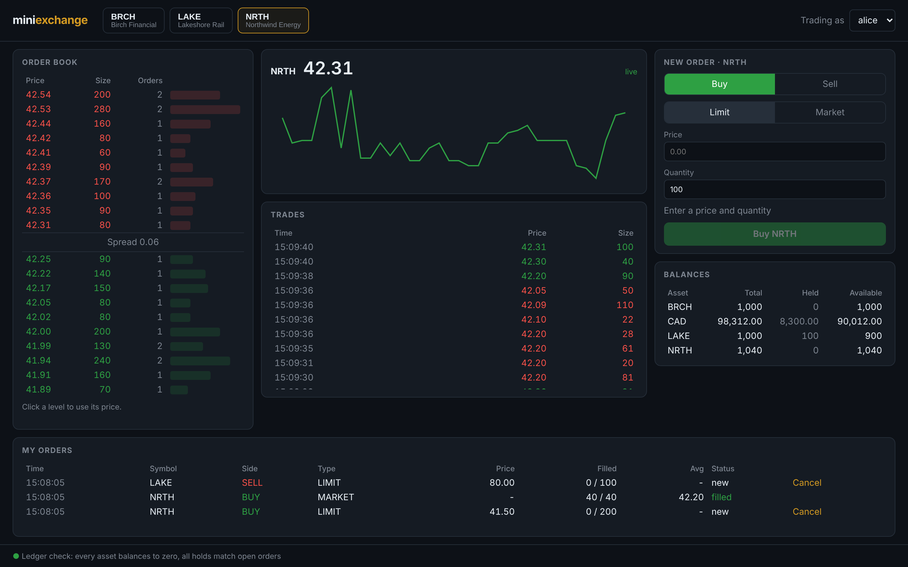
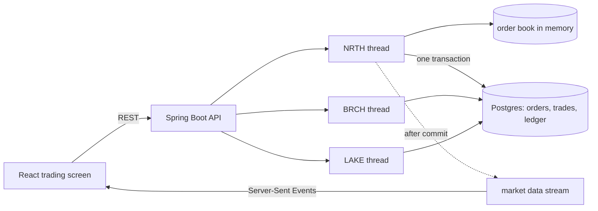

# mini-exchange

[](https://github.com/nagarjuna-thumma/mini-exchange/actions/workflows/build.yml)

A small stock exchange: a price-time priority matching engine, a double-entry settlement ledger in Postgres, and a live trading screen in React.



I wanted something that shows the parts of financial systems that are easy to get subtly wrong: concurrent orders racing for the same money, keeping an in-memory engine and a database in agreement, and proving afterwards that not a cent went missing.

## How it fits together



Each symbol has its own order book and a single thread that owns it. Orders for the same stock are handled strictly one at a time in arrival order, so matching is deterministic and the engine needs no locks. Different stocks run in parallel.

## The matching engine

`OrderBook` is plain Java with no Spring and no database, so it's easy to test on its own.

- **Price-time priority.** Best price first. At the same price, whoever arrived first fills first.
- **Trade price is the resting order's price.** A buy at 10.50 that hits an ask at 10.00 trades at 10.00.
- **Limit and market orders.** Limit orders rest with any unfilled remainder. Market orders sweep the book and never rest: whatever can't fill is cancelled.
- **Partial fills** on both sides.
- **Self-trade prevention.** If an order would match one of the same trader's resting orders, the resting order is cancelled instead. Trading with yourself is wash trading.

## Settlement and the ledger

Every trader has one account per asset (CAD cash, and shares of each stock). Balances only ever change through ledger transactions made of postings, and each transaction must net to zero per asset. A trade is four postings: the buyer's cash goes down, the seller's cash goes up, the seller's shares go down and the buyer's shares go up.

The database enforces the important rules itself, so a bug in the Java code can't break them:

- A deferred constraint trigger rejects any transaction whose postings don't balance per asset at commit.
- Postings are append-only. A trigger blocks updates and deletes.
- A check constraint stops any trader's balance falling below what their open orders have reserved.

**Holds.** Placing an order reserves what it could spend: a buy limit holds `price × quantity` of cash, and a sell holds the shares. If a buy fills at a better price than its limit, the difference is released. Cancelling releases the rest. That's how you can't sell the same shares twice from two different screens.

**Locking.** Cash is shared across symbols, so two symbol threads can touch the same trader's CAD account at once. Account rows are always locked in id order, so those transactions queue up instead of deadlocking.

## Keeping memory and the database in step

The book in memory changes before the database transaction commits. If anything in that transaction fails, the book for that symbol is thrown away and rebuilt from the open orders in Postgres, so memory never gets ahead of what was stored. The same rebuild runs on startup: stop the app mid-session and every resting order is back in the same time order when it starts again.

## Proving nothing went missing

`GET /api/ledger/check` audits everything in one consistent snapshot:

- every asset sums to zero across all accounts
- every account balance equals the sum of its postings
- every account's held amount equals what its open orders reserve

The trading screen runs this every few seconds and shows the result in the footer.

## Running it

You need Java 21, Node 22 and Docker.

```bash
docker compose up -d                                   # Postgres on 5436

cd backend
mvn spring-boot:run -Dspring-boot.run.profiles=demo    # API on 8080

cd frontend
npm install
npm run dev                                            # http://localhost:5173
```

The `demo` profile opens three traders (alice, bob, carol) with cash and shares, plus two market-making bots that quote around a drifting price so the book and the chart move. Pick a trader in the top right and trade against the bots.

## API

| Method | Path | |
|---|---|---|
| POST | `/api/orders` | Place an order. 201 if accepted, 422 with the reason if rejected |
| DELETE | `/api/orders/{id}?symbol=&traderId=` | Cancel an open order |
| GET | `/api/market/{symbol}/depth` | Aggregated order book |
| GET | `/api/market/{symbol}/trades` | Last 100 trades |
| GET | `/api/market/{symbol}/stream` | Live depth and trades (Server-Sent Events) |
| GET | `/api/traders/{id}/balances` | Balance, held and available per asset |
| GET | `/api/traders/{id}/orders` | Recent orders |
| GET | `/api/ledger/check` | Full ledger audit |

There's no login here on purpose, to keep the focus on the exchange. Authentication with OAuth2 and JWTs is in my [expense-claims-api](https://github.com/nagarjuna-thumma/expense-claims-api) project.

## Tests

```bash
cd backend && mvn verify     # 26 tests, needs Docker for Testcontainers
cd frontend && npm test      # 8 tests
```

- `OrderBookTest` covers the matching rules one by one.
- `OrderBookRandomizedTest` throws 5,000 random orders and cancels at the book with several seeds, and after every step checks that the book is never crossed, no quantity is created or lost, and no fill breaks a limit price.
- `ExchangeIntegrationTest` runs against a real Postgres. It checks settlement and holds, rejection of unaffordable orders, cancels, that the database refuses unbalanced or edited postings, and that a rebuilt book matches the live one exactly. One test fires 600 orders from 12 threads across three stocks and then runs the full ledger audit.
- Front-end tests cover the order ticket's validation and the order book layout.

## Stack

Java 21 · Spring Boot 3.5 · Spring Data JPA · PostgreSQL 16 · Flyway · Testcontainers · React 19 · TypeScript · Vite · Vitest · GitHub Actions

## What I'd do next

- Journal incoming orders to Kafka before matching, so the engine can be replayed and a hot standby can follow it
- Add stop and IOC/FOK order types
- Move holds and the ledger check into a separate risk service
- Add authentication and per-trader rate limits
